# MaraClaw

🦞 MaraClaw is a multi-tenant platform for OpenClaw-backed digital employees used by teams and companies.

## How the system works

Members work with digital employees through a browser workspace or configured messaging channels. Organization and platform administrators use a separate console to manage access, models, tools, and platform settings. The engine enforces tenant boundaries, persists work, and manages the OpenClaw guests that execute agent tasks.

The diagrams below describe the implementation and checked-in launcher defaults reviewed on **2026-11-01**, with the search provider updated to Tavily on **2026-11-07** and the engine dispatch and chat-flow diagrams updated on **2026-11-12**. Open an image to inspect it at full size. The [architecture documentation](docs/architectures/README.md) includes editable Mermaid sources, implementation references, and rendering instructions.

### 1. People and external services

MaraClaw connects members and administrators to the same platform. Configured integrations provide identity sign-in, email, messaging, model inference, and Tavily search. These integrations are optional capabilities; the diagram does not imply that every provider is enabled in a deployment.

### 2. Applications, agent runtimes, and state

The repository contains three independently configured applications:

| Package | Responsibility |
| --- | --- |
| [`web-e/`](web-e/) | Public landing, member authentication, and the member workspace, including chat |
| [`web-a/`](web-a/) | Organization and platform administration |
| [`engine/`](engine/) | FastAPI APIs, authorization, persistence, background work, connectors, and guest management |

Both frontends are React applications that run in the browser. Their production images use nginx to serve the built assets and proxy engine requests. The engine manages separate, dynamically created OpenClaw guest containers for agent execution; the guest image recipe is maintained outside this repository.

PostgreSQL stores durable platform records, chat transcripts, gateway work, and reply-delivery intents. Redis supplies short-lived tickets, caches, presence, and cross-instance events, rather than the durable work queue. Agent workspaces use host-mounted directories; file storage defaults to local storage and can be configured for an S3-compatible backend.

### 3. Engine coordination

The default engine process runs with `PROCESS_ROLE=all`. It owns API realtime subscriptions, worker loops for scheduling and recovery, and configured messaging connectors. Roles can be split through configuration, but the launchers do not automatically deploy separate API, worker, and connector services; HTTP routers remain mounted for every role.

Chat and channel intake authorize incoming work and hand it to OpenClaw dispatch. The engine runs each turn in the guest and settles the adapter's terminal result through the gateway layer, which persists completion before attempting live notification. A worker-owned report relay separately handles durable messaging and agent-to-agent reply intents.

### 4. From a chat message to an answer

1. The member application obtains a single-use chat ticket over authenticated HTTP, then opens a ticket-authorized WebSocket. The engine rechecks access for submitted turns.
2. The engine commits the user message, quota charge, session update, and gateway work together in PostgreSQL before acknowledging acceptance.
3. After commit, the engine wakes native dispatch, and a worker-owned reconciler rescans pending lane heads every second as the recovery path. Each turn runs in the label-proven guest through `docker exec` of the Node adapter ([`gateway-rpc.mjs`](engine/connectors/openclaw-dispatcher/gateway-rpc.mjs)) over the guest's local Gateway WebSocket; only a proven refusal before admission releases a claim, and shared conversations keep FIFO serialized claims.
4. The adapter returns the terminal result, streaming web deltas when applicable, and the engine settles it. The first accepted completion commits the assistant response, when non-empty, together with applicable reply intents.
5. The engine attempts to notify connected clients directly or through Redis routing. Live notification is best effort: missing an event does not erase the persisted transcript. The report relay handles applicable messaging and agent replies separately.

### 5. Launcher deployment topology

Each package has its own `start-from-docker.sh`. By default, the launchers share `maraclaw_network`, expose the member UI on port **5173**, the admin UI on **5174**, and the engine on **8000**. Member nginx proxies `/api/`, `/ws/`, and `/p/`; admin nginx proxies `/api/`.

The engine uses the container daemon to create sibling OpenClaw guests and bind their agent directories from the host. PostgreSQL and Redis must be supplied separately through reachable configured endpoints. This view describes launcher behavior, not proof of a running deployment; TLS termination and other production infrastructure are outside these launchers.

