# Engine runtime and dispatch components

[Architecture index](README.md) | Source snapshot: **2026-11-12**

This is a focused runtime/dispatch view inside the engine, not an exhaustive API or service inventory. Components share the engine deployment by default; roles gate startup work in the [lifecycle owner](../../engine/app/runtime/lifecycle.py#L68-L239), while [HTTP/WebSocket routers remain mounted](../../engine/app/main.py#L156-L221).

```mermaid
%%{init: {"c4": {"c4ShapeMargin": 170, "c4ShapePadding": 20, "width": 260, "height": 100, "boxMargin": 30, "diagramMarginX": 60, "diagramMarginY": 60}}}%%
C4Component
  title MaraClaw engine - Runtime and dispatch

  Container(memberApp, "Member application", "React browser client", "Submits turns and receives live events")
  System_Ext(im, "IM platforms", "Configured inbound and reply transports")
  Container(guests, "OpenClaw guests", "Managed guest containers", "Executes accepted agent work")

  Container_Boundary(engine, "engine - one runtime by default") {
    Component(intake, "Chat and channel intake", "FastAPI, Python", "Fresh access checks and idempotent acceptance")
    Component(runtime, "Runtime owner", "Python lifespan", "Owns resources and role-gated tasks")
    Component(reconciler, "Dispatch reconciler", "Python worker loop", "Rescans pending lane heads each second")
    Component(gateway, "Gateway settlement", "FastAPI, Python", "First-completion commit; report API")
    Component(dispatch, "OpenClaw dispatch", "Python services", "Prepares models, queues work, runs claimed turns")
    Component(relay, "Report relay", "Python worker loop", "Claims durable IM and agent reply intents")
    Component(realtime, "Realtime router", "Python", "Local WebSocket and remote-instance delivery")
  }

  Boundary(state, "External state services", "Data boundary") {
    ContainerDb(redis, "Realtime coordination", "Redis", "Tickets, presence, Pub/Sub")
    ContainerDb(postgres, "Durable records", "PostgreSQL", "Transcripts, gateway rows, delivery intents")
  }

  Rel(memberApp, intake, "Submits turns", "HTTP / JSON, WebSocket")
  Rel(im, intake, "Delivers events", "HTTPS / provider streams")
  Rel(runtime, realtime, "Starts API subscriber", "Python tasks")
  Rel(intake, dispatch, "Accepts and enqueues", "Python / transaction")
  Rel(dispatch, postgres, "Persists and claims work", "SQL / transaction")
  Rel(dispatch, guests, "Runs claimed turns", "Docker exec / Node adapter, local Gateway WS")
  Rel(dispatch, gateway, "Settles terminal results", "Python / settle_native_report")
  Rel(gateway, realtime, "Attempts live delivery", "Python calls")
  Rel(realtime, redis, "Routes remote events", "Redis / Pub/Sub")
  Rel(relay, postgres, "Leases reply intents", "SQL / checkpoints")
  Rel(relay, im, "Sends reply chunks", "Provider API / transport")
  Rel(relay, dispatch, "Queues agent replies", "Python / transaction")
  Rel(reconciler, dispatch, "Rewakes pending heads", "Python / 1 s scan")

  UpdateLayoutConfig($c4ShapeInRow="3", $c4BoundaryInRow="1")
  UpdateRelStyle(memberApp, intake, $offsetX="-160", $offsetY="0")
  UpdateRelStyle(im, intake, $offsetX="-60", $offsetY="-90")
  UpdateRelStyle(runtime, realtime, $offsetX="105", $offsetY="-310")
  UpdateRelStyle(intake, dispatch, $offsetX="30", $offsetY="0")
  UpdateRelStyle(dispatch, postgres, $offsetX="20", $offsetY="30")
  UpdateRelStyle(dispatch, guests, $offsetX="-410", $offsetY="0")
  UpdateRelStyle(dispatch, gateway, $offsetX="-165", $offsetY="-85")
  UpdateRelStyle(gateway, realtime, $offsetX="20", $offsetY="0")
  UpdateRelStyle(realtime, redis, $offsetX="20", $offsetY="0")
  UpdateRelStyle(relay, postgres, $offsetX="85", $offsetY="30")
  UpdateRelStyle(relay, im, $offsetX="130", $offsetY="0")
  UpdateRelStyle(relay, dispatch, $offsetX="-55", $offsetY="12")
  UpdateRelStyle(reconciler, dispatch, $offsetX="-160", $offsetY="-10")
```

Editable Mermaid C4 source

## Runtime ownership

All valid roles open the database pool. API starts the realtime subscriber; worker starts scheduling, triggers, setup/start recovery, native dispatch recovery, the report relay, and update/export loops; connector starts IM managers and the Personal WhatsApp supervisor. These are owned tasks, not individually deployed microservices: [startup](../../engine/app/runtime/lifecycle.py#L68-L239). The supervisor's bridge uses a [child-process protocol](../../engine/app/services/channels/whatsapp_personal_child.py#L42-L80), not an extra public API server.

The [entrypoint](../../engine/entrypoint.sh#L68-L96) performs schema bootstrap before Uvicorn for `all`/`bootstrap`; runtime bootstrap is separate lifecycle work. A bootstrap-only process is not ready according to [readiness eligibility](../../engine/app/runtime/readiness.py#L24-L38).

## Dispatch and durability

- Web acceptance reserves a submission, checks quota, updates the session, and queues gateway work in one transaction: [chat submissions](../../engine/app/services/chat_submissions.py#L69-L139). IM acceptance reauthorizes the sender and uses durable provider receipts; ordinary events join shared dispatch, while Personal WhatsApp originals take their batching path: [channel submissions](../../engine/app/services/channels/submissions.py#L108-L244).
- [Routing](../../engine/app/services/openclaw_routing.py#L52-L85) prepares the guest model configuration before queue insertion, and [enqueue](../../engine/app/services/openclaw_routing.py#L88-L112) wakes native dispatch after commit. [`NativeDispatcher`](../../engine/app/services/openclaw_native_dispatch.py#L19-L171) runs one task per conversation lane, bounded per agent by `OPENCLAW_AGENT_MAX_PARALLEL_TURNS` and per process by `OPENCLAW_PROCESS_MAX_PARALLEL_TURNS` ([capacity](../../engine/app/services/openclaw_native_capacity.py#L46-L63)); shared conversations remain one FIFO lane. Each claimed turn runs through [`execute_gateway_turn`](../../engine/app/services/openclaw_gateway_rpc.py#L171-L322): a `docker exec` of the Node [adapter](../../engine/connectors/openclaw-dispatcher/gateway-rpc.mjs#L44) against the guest's local Gateway WebSocket, ending in a `terminal`, `not_admitted`, or `uncertain` outcome. Only `not_admitted` (or a lock, configuration, or update-gate refusal before any request) releases the claim, and the released lane waits out a process-local [backoff](../../engine/app/services/openclaw_release_backoff.py#L24-L56) (1 s, doubling to at most 30 s); an uncertain turn stays delivered. The worker-owned [dispatch reconciler](../../engine/app/services/openclaw_dispatch_reconciler.py#L38-L91) is the recovery path: it rescans pending lane heads every second in keyset pages of 50 and never replays delivered work. PostgreSQL, not a Redis queue, holds the work.
- [First-report-wins settlement](../../engine/app/services/openclaw_gateway_delivery.py#L44-L115) commits completion, a non-empty assistant response, and applicable reply intents together; the engine settles the adapter's terminal result through `settle_native_report`, and the independent `POST /api/gateway/report` also reaches `record_report`. There is no poll route. Web turns also stream bounded, best-effort [deltas](../../engine/app/services/openclaw_gateway_stream.py#L91-L170) that never carry the terminal result. [Realtime publication](../../engine/app/services/openclaw_gateway_delivery.py#L170-L198) is best effort; [Redis routing](../../engine/app/services/realtime_runtime/router.py#L161-L211) is for live delivery. The [worker relay](../../engine/app/services/gateway_report_relay.py#L119-L264) separately leases, sends, checkpoints, and retries IM/agent destinations. Durable intent does not imply exactly-once provider delivery.

Engine-side feature LLM clients are outside this focused dispatch view. They are built by the [LLM factory](../../engine/app/services/llm/factory.py#L50-L116); they are not a mandatory hop for guest answers.
