# Engine runtime and dispatch components

[Architecture index](README.md) | Source snapshot: **2026-11-01**

This is a focused runtime/dispatch view inside the engine, not an exhaustive API or service inventory. Components share the engine deployment by default; roles gate startup work in the [lifecycle owner](../../engine/app/runtime/lifecycle.py#L66-L146), while [HTTP/WebSocket routers remain mounted](../../engine/app/main.py#L130-L191).

```mermaid
%%{init: {"c4": {"c4ShapeMargin": 170, "c4ShapePadding": 20, "width": 260, "height": 100, "boxMargin": 30, "diagramMarginX": 60, "diagramMarginY": 60}}}%%
C4Component
  title MaraClaw engine - Runtime and dispatch

  Container(memberApp, "Member application", "React browser client", "Submits turns and receives live events")
  System_Ext(im, "IM platforms", "Configured inbound and reply transports")
  Container(guests, "OpenClaw guests", "Managed guest containers", "Executes accepted agent work")

  Container_Boundary(engine, "engine - one runtime by default") {
    Component(intake, "Chat and channel intake", "FastAPI, Python", "Fresh access checks and idempotent acceptance")
    Component(runtime, "Runtime owner", "Python lifespan", "Owns resources and role-gated tasks")
    Component(gateway, "Gateway settlement", "FastAPI, Python", "Authenticated poll and first-report commit")
    Component(realtime, "Realtime router", "Python", "Local WebSocket and remote-instance delivery")
    Component(dispatch, "OpenClaw dispatch", "Python services", "Prepares models, queues work, wakes guests")
    Component(relay, "Report relay", "Python worker loop", "Claims durable IM and agent reply intents")
  }

  Boundary(state, "External state services", "Data boundary") {
    ContainerDb(redis, "Realtime coordination", "Redis", "Tickets, presence, Pub/Sub")
    ContainerDb(postgres, "Durable records", "PostgreSQL", "Transcripts, gateway rows, delivery intents")
  }

  Rel(memberApp, intake, "Submits turns", "HTTP / JSON, WebSocket")
  Rel(im, intake, "Delivers events", "HTTPS / provider streams")
  Rel(runtime, realtime, "Starts API subscriber", "Python tasks")
  Rel(intake, dispatch, "Accepts and enqueues", "Python / transaction")
  Rel(dispatch, postgres, "Persists accepted work", "SQL / transaction")
  Rel(dispatch, guests, "Attempts committed wake", "Docker exec / guest hook")
  Rel(guests, gateway, "Polls and reports", "HTTP / JSON; X-Api-Key")
  Rel(gateway, realtime, "Attempts live delivery", "Python calls")
  Rel(realtime, redis, "Routes remote events", "Redis / Pub/Sub")
  Rel(relay, postgres, "Leases reply intents", "SQL / checkpoints")
  Rel(relay, im, "Sends reply chunks", "Provider API / transport")
  Rel(relay, dispatch, "Queues agent replies", "Python / transaction")

  UpdateLayoutConfig($c4ShapeInRow="3", $c4BoundaryInRow="1")
  UpdateRelStyle(memberApp, intake, $offsetX="-130", $offsetY="-70")
  UpdateRelStyle(im, intake, $offsetX="-90", $offsetY="-130")
  UpdateRelStyle(runtime, realtime, $offsetX="-160", $offsetY="-60")
  UpdateRelStyle(intake, dispatch, $offsetX="-70", $offsetY="90")
  UpdateRelStyle(dispatch, postgres, $offsetX="-170", $offsetY="20")
  UpdateRelStyle(dispatch, guests, $offsetX="30", $offsetY="-130")
  UpdateRelStyle(guests, gateway, $offsetX="40", $offsetY="-100")
  UpdateRelStyle(gateway, realtime, $offsetX="-120", $offsetY="-70")
  UpdateRelStyle(realtime, redis, $offsetX="-160", $offsetY="20")
  UpdateRelStyle(relay, postgres, $offsetX="50", $offsetY="100")
  UpdateRelStyle(relay, im, $offsetX="100", $offsetY="-20")
  UpdateRelStyle(relay, dispatch, $offsetX="-90", $offsetY="50")
```

Editable Mermaid C4 source

## Runtime ownership

All valid roles open the database pool. API starts the realtime subscriber; worker starts scheduling, triggers, setup/start recovery, the report relay, and update/export loops; connector starts IM managers and the Personal WhatsApp supervisor. These are owned tasks, not individually deployed microservices: [startup](../../engine/app/runtime/lifecycle.py#L66-L146). The supervisor's bridge uses a [child-process protocol](../../engine/app/services/channels/whatsapp_personal_child.py#L42-L80), not an extra public API server.

The [entrypoint](../../engine/entrypoint.sh#L68-L96) performs schema bootstrap before Uvicorn for `all`/`bootstrap`; runtime bootstrap is separate lifecycle work. A bootstrap-only process is not ready according to [readiness eligibility](../../engine/app/runtime/readiness.py#L24-L38).

## Dispatch and durability

- Web acceptance reserves a submission, checks quota, updates the session, and queues gateway work in one transaction: [chat submissions](../../engine/app/services/chat_submissions.py#L69-L134). IM acceptance reauthorizes the sender and uses durable provider receipts; ordinary events join shared dispatch, while Personal WhatsApp originals take their batching path: [channel submissions](../../engine/app/services/channels/submissions.py#L105-L233).
- [Routing](../../engine/app/services/openclaw_routing.py#L76-L152) prepares the guest model configuration before queue insertion and schedules a wake after commit. A [guarded guest hook](../../engine/app/services/openclaw_inbox.py#L332-L426) accelerates dispatch; the [gateway poll API](../../engine/app/api/gateway.py#L60-L138) is another consumer of durable work, not a Redis queue consumer.
- [First-report-wins settlement](../../engine/app/services/openclaw_gateway_delivery.py#L73-L137) commits completion, a non-empty assistant response, and applicable reply intents together. [Realtime publication](../../engine/app/services/openclaw_gateway_delivery.py#L140-L167) is best effort; [Redis routing](../../engine/app/services/realtime_runtime/router.py#L115-L218) is for live delivery. The [worker relay](../../engine/app/services/gateway_report_relay.py#L116-L262) separately leases, sends, checkpoints, and retries IM/agent destinations. Durable intent does not imply exactly-once provider delivery.

Engine-side feature LLM clients are outside this focused dispatch view. They are built by the [LLM factory](../../engine/app/services/llm/factory.py#L50-L116); they are not a mandatory hop for guest answers.
