# Containers and state boundaries

[Architecture index](README.md) | Source snapshot: **2026-11-01**

The three packages are independently built and launched, not a root npm workspace. The frontend containers below represent separately shipped SPA applications with nginx delivery; React executes in the browser, not on the nginx server. Node/Vite are build-time tools in the [web-e image](../../web-e/Dockerfile#L25-L71) and [web-a image](../../web-a/Dockerfile#L32-L83). The [deployment view](c4-deployment.md) separates browser instances from servers.

```mermaid
%%{init: {"c4": {"c4ShapeMargin": 150, "c4ShapePadding": 20, "width": 260, "height": 100, "boxMargin": 30, "diagramMarginX": 60, "diagramMarginY": 60}}}%%
C4Container
  title MaraClaw - Containers and state

  Person(member, "Member", "Works with digital employees")
  ContainerDb_Ext(objects, "Optional object storage", "S3-compatible API", "Configured file-storage backend")
  Person(operator, "Admin", "Operates the platform or organization")

  System_Boundary(platform, "MaraClaw") {
    Container(memberApp, "web-e", "React, TypeScript; nginx delivery", "Public and member browser application")
    Container(engine, "engine", "Python, FastAPI, Uvicorn", "API, workers, connectors, guest management")
    Container(adminApp, "web-a", "React, TypeScript; nginx delivery", "Admin browser application")
    ContainerDb(postgres, "Platform records", "PostgreSQL, psycopg", "Durable domain, chat, work, delivery state")
    Container(guests, "OpenClaw guests", "Managed OpenClaw containers", "Dynamic per-agent execution runtimes")
    ContainerDb(redis, "Coordination state", "Redis", "Tickets, cache, presence, Pub/Sub")
    ContainerDb(files, "Agent workspaces", "Host filesystem", "Bind-mounted guest state and local files")
  }

  Rel(member, memberApp, "Opens workspace", "HTTP(S)")
  Rel(operator, adminApp, "Opens console", "HTTP(S)")
  Rel(memberApp, engine, "Calls APIs / chat", "HTTP / WS via proxy")
  Rel(adminApp, engine, "Calls admin APIs", "HTTP / JSON via proxy")
  Rel(engine, postgres, "Commits records", "SQL / psycopg")
  Rel(engine, redis, "Coordinates live state", "Redis / Pub/Sub")
  Rel(engine, guests, "Manages and wakes", "Docker CLI / API")
  Rel(guests, engine, "Polls and reports", "HTTP / JSON; X-Api-Key")
  Rel(engine, files, "Writes config / files", "Filesystem I/O")
  Rel(guests, files, "Reads and writes", "Bind mount / filesystem")
  Rel(engine, objects, "Stores selected files", "S3 / HTTP(S)")

  UpdateLayoutConfig($c4ShapeInRow="3", $c4BoundaryInRow="1")
  UpdateRelStyle(member, memberApp, $offsetX="-100", $offsetY="-20")
  UpdateRelStyle(operator, adminApp, $offsetX="30", $offsetY="-20")
  UpdateRelStyle(engine, objects, $offsetX="30", $offsetY="-20")
  UpdateRelStyle(memberApp, engine, $offsetX="-70", $offsetY="-45")
  UpdateRelStyle(adminApp, engine, $offsetX="-75", $offsetY="-45")
  UpdateRelStyle(engine, postgres, $offsetX="-110", $offsetY="-30")
  UpdateRelStyle(engine, redis, $offsetX="80", $offsetY="-30")
  UpdateRelStyle(engine, guests, $offsetX="-170", $offsetY="-60")
  UpdateRelStyle(guests, engine, $offsetX="30", $offsetY="30")
  UpdateRelStyle(engine, files, $offsetX="-180", $offsetY="75")
  UpdateRelStyle(guests, files, $offsetX="-100", $offsetY="20")
```

## Sources and interpretation

- Empty `VITE_API_BASE_URL` uses same-origin requests: [member URL builder](../../web-e/src/lib/api.ts#L1-L47), [admin URL builder](../../web-a/src/lib/api.ts#L1-L26). In the images, member nginx proxies `/api/`, WebSocket-upgraded `/ws/`, and `/p/`; admin nginx proxies `/api/` only: [member proxy](../../web-e/docker/nginx.conf#L62-L90), [admin proxy](../../web-a/docker/nginx.conf#L65-L74). Development instead uses [member Vite proxies](../../web-e/vite.config.ts#L23-L40) and the [admin Vite proxy](../../web-a/vite.config.ts#L17-L27).
- One default engine enables bootstrap, API, worker, and connector responsibilities with `PROCESS_ROLE=all`: [setting](../../engine/app/config.py#L162-L167), [runtime startup](../../engine/app/runtime/lifecycle.py#L66-L146). Optional role splitting is configuration, not evidence of deployed microservices; [router mounts](../../engine/app/main.py#L130-L191) remain unconditional.
- PostgreSQL is the durable authority. [Transaction scopes](../../engine/app/db/session.py#L80-L120) join DAO writes; [chat acceptance](../../engine/app/services/chat_submissions.py#L88-L134) and [report settlement](../../engine/app/services/openclaw_gateway_delivery.py#L73-L137) commit transcript, gateway work, and applicable delivery intents. Redis [single-use tickets](../../engine/app/services/chat_tickets.py#L70-L121) and [presence/PubSub](../../engine/app/services/realtime_runtime/router.py#L63-L165) are not a durable task queue.
- Local storage is the default; the [storage facade](../../engine/app/services/storage_runtime/facade.py#L17-L43) can select S3-compatible storage with optional local read fallback. That choice does not remove the filesystem required by [guest bind mounts](../../engine/app/services/agent_manager.py#L671-L685). PostgreSQL, Redis, and optional object storage must be supplied/configured separately; the [package launcher](../../engine/start-from-docker.sh#L129-L214) does not provision them.
- External identity, email, IM, model, and search services are grouped in the [context view](c4-context.md). Guest inference follows guest configuration, not necessarily engine-side LLM clients: [guest preparation](../../engine/app/services/openclaw_routing.py#L76-L125), [engine factory](../../engine/app/services/llm/factory.py#L50-L116).
