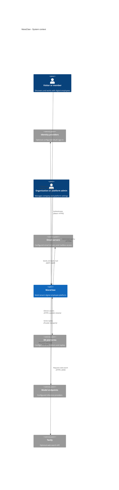

# System context

[Architecture index](README.md) | Source snapshot: **2026-11-01**; Tavily integration updated **2026-11-07**.

MaraClaw provides a public/member workspace and an operator console around OpenClaw-backed digital employees. The actors and product surfaces follow the [member routes](../../web-e/src/routes/index.tsx#L48-L106) and [admin routes](../../web-a/src/routes/index.tsx#L56-L105).

Editable Mermaid C4 source

## Sources and boundaries

- Identity is optional: the [provider registry](../../engine/app/services/auth_provider.py#L915-L923) includes Feishu, DingTalk, WeCom, Google Workspace, Microsoft Teams, Google, and GitHub. This is a sign-in boundary, not a provider organization-directory sync service.
- Email covers [SMTP transport](../../engine/app/core/email.py#L67-L134) and [per-agent SMTP/IMAP configuration](../../engine/app/services/email_service.py#L1-L59); it is not modeled as a universal inbound chat channel.
- IM groups provider-specific transports rather than claiming uniform features. [Connector managers](../../engine/app/runtime/lifecycle.py#L39-L52) cover Feishu, DingTalk, WeCom, WeChat, and Discord; [mounted channel routes](../../engine/app/main.py#L162-L170) also expose webhook/API integrations. The Personal WhatsApp bridge is an engine-owned child transport, not a separate public server: [lifecycle](../../engine/app/runtime/lifecycle.py#L128-L139), [child protocol](../../engine/app/services/channels/whatsapp_personal_child.py#L42-L80).
- Model endpoints serve both configured OpenClaw guests and engine-side features. [Guest configuration](../../engine/app/services/openclaw_routing.py#L76-L125) is distinct from the [engine LLM client factory](../../engine/app/services/llm/factory.py#L50-L116); guest answers are not assumed to traverse that factory.
- Tavily is backed by the [upstream client](../../engine/app/services/tavily/client.py) and [engine proxy](../../engine/app/api/tavily_proxy.py). Search uses Tavily's `query` and `search_depth` request fields and `results` response. [Guest configuration](../../engine/app/services/agent_manager.py) supplies the agent-bound proxy endpoint and token; bundled guest skills and the guest image recipe are maintained outside this repository.

Internal databases, Redis, and guest processes are deliberately deferred to the [container view](c4-containers.md).
