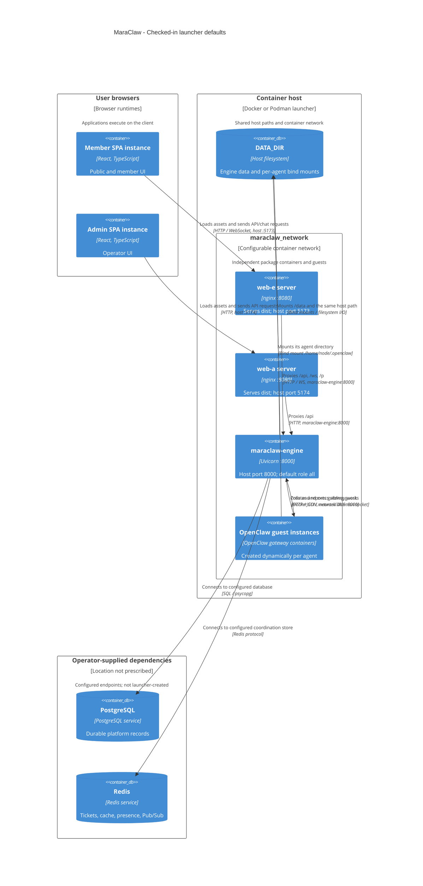

# Checked-in launcher topology

[Architecture index](README.md) | Source snapshot: **2026-11-01**

This diagram describes the default topology encoded by [engine](../../engine/start-from-docker.sh#L129-L214), [web-e](../../web-e/start-from-docker.sh#L29-L32), and [web-a](../../web-a/start-from-docker.sh#L29-L32) launchers. It is not evidence that these containers, databases, or network paths are running. No cloud, Compose, Kubernetes, TLS terminator, or database provisioning is implied.

## Defaults and prerequisites

| Concern | Checked-in behavior and source |
| --- | --- |
| Package serving | Frontend defaults are host `5173 -> 8080` and `5174 -> 8080`; engine is `8000 -> 8000`. Overrides are launcher inputs: [web-e](../../web-e/start-from-docker.sh#L29-L32), [web-a](../../web-a/start-from-docker.sh#L29-L32), [engine](../../engine/start-from-docker.sh#L63-L67). Node builds the assets; nginx serves them: [web-e image](../../web-e/Dockerfile#L43-L71), [web-a image](../../web-a/Dockerfile#L55-L83). |
| Shared network | All three launchers create/join `DOCKER_NETWORK` (default `maraclaw_network`). Engine receives DNS alias `maraclaw-engine`: [engine network and run arguments](../../engine/start-from-docker.sh#L129-L183), [member launcher](../../web-e/start-from-docker.sh#L72-L87), [admin launcher](../../web-a/start-from-docker.sh#L72-L87). Start engine before frontend nginx resolves the upstream. |
| Proxy paths | Member nginx proxies `/api/`, `/ws/` with upgrade headers, and `/p/`; admin proxies `/api/` only: [member config](../../web-e/docker/nginx.conf#L62-L90), [admin config](../../web-a/docker/nginx.conf#L65-L74). These checked-in listeners use HTTP; production HTTPS needs separately supplied infrastructure. |
| Dependencies | Supply reachable `DATABASE_URL` and `REDIS_URL`; launchers do not start database or Redis servers: [settings](../../engine/app/config.py#L97-L108), [engine run configuration](../../engine/start-from-docker.sh#L129-L229). Their placement in the diagram is intentionally unspecified. |
| Host path identity | Engine mounts `DATA_DIR` at both `/data` and the same absolute host path, and pins `AGENT_DATA_DIR` and `STORAGE_LOCAL_ROOT` to its `agents` directory. This lets sibling guest mounts resolve on the daemon host: [launcher](../../engine/start-from-docker.sh#L129-L183), [guest mount](../../engine/app/services/agent_manager.py#L671-L685). |
| Docker control | Launcher mounts a Linux Docker CLI and mounts the daemon socket when available; without it, guest creation fails: [launcher](../../engine/start-from-docker.sh#L189-L214). Guests join the shared network and publish their gateway only on host loopback `127.0.0.1:<allocated-port>`: [guest run arguments](../../engine/app/services/agent_manager.py#L671-L685). |

The default is one engine with `PROCESS_ROLE=all`, not separate deployed API/worker/connector services: [setting](../../engine/app/config.py#L162-L183), [startup](../../engine/app/runtime/lifecycle.py#L66-L146). Schema bootstrap runs before Uvicorn for `all`/`bootstrap`: [entrypoint](../../engine/entrypoint.sh#L68-L96). Optional [S3-compatible file storage](../../engine/app/services/storage_runtime/facade.py#L17-L43), external integrations, and the engine-owned Personal WhatsApp child are omitted here to keep the launcher topology focused. Guest image construction is external to this repository; the engine consumes a configured image and manages instances. No build or live readiness claim is made.
