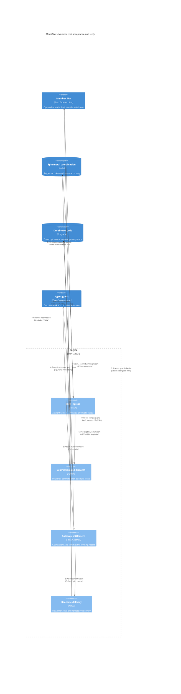

# Durable member chat flow

[Architecture index](README.md) | Source snapshot: **2026-11-01**

This view follows a normal member submission through ticket authorization, durable gateway work, and reply settlement. It omits attachment handling and onboarding triggers. Nginx transport is collapsed into the client-to-engine arrow; see the [deployment view](c4-deployment.md) for the actual proxy hop.

Editable Mermaid C4 source

## Sequence and guarantees

1. **Ticket and socket.** Bearer-authenticated `POST /api/auth/chat-ticket` issues a Redis-backed, single-use ticket; the browser then connects to `/ws/chat/{agent_id}` with the bound session and ticket, not a JWT in the URL. Redemption uses `GETDEL`. Setup and each submitted turn freshly reauthorize the principal, tenant, agent, and session. Steps 1-2 compress this handshake, not parallel actions: [ticket endpoint](../../engine/app/api/auth.py#L72-L82), [ticket service](../../engine/app/services/chat_tickets.py#L47-L121), [socket setup](../../engine/app/api/websocket.py#L201-L299), [per-turn checks](../../engine/app/api/websocket.py#L329-L378).
2. **Durable acceptance before acknowledgement.** `accept_submission` locks the session, checks a submission UUID/fingerprint for replay or conflict, prepares guest configuration, reserves the user transcript, charges quota, updates the session, and inserts gateway work within the owning transaction. Guest configuration is a filesystem side effect, not part of database rollback. Only after successful acceptance does the socket send `turn_accepted`; that acknowledges acceptance, not a finished guest answer: [submission transaction](../../engine/app/services/chat_submissions.py#L69-L134), [model/config preparation](../../engine/app/services/openclaw_routing.py#L76-L152), [socket acknowledgement](../../engine/app/api/websocket.py#L461-L534).
3. **Wake and poll are alternative dispatch paths.** The post-commit wake attempts a bootstrap-guarded Docker-exec hook. Failure does not discard committed work. Ordinary claims can be returned to pending or reclaimed after the configured stale-delivery timeout, allowing authenticated `GET /api/gateway/poll` to pick them up. A shared conversation instead uses a serialized shared-lane claim: stale ordinary-delivery requeue explicitly excludes shared turns; a shared wake is released only when bootstrap refusal proves it was not admitted. The polling edge does not imply unconditional retry of every shared turn: [wake/claim handling](../../engine/app/services/openclaw_routing.py#L187-L248), [guarded hooks and shared CLI fallback](../../engine/app/services/openclaw_inbox.py#L332-L426), [poll claims](../../engine/app/services/openclaw_gateway_delivery.py#L43-L70), [poll endpoint](../../engine/app/api/gateway.py#L60-L138).
4. **Completion is durable; live notification is not.** The guest reports through `POST /api/gateway/report` using `X-Api-Key`. First-report-wins settlement commits gateway completion and, for a non-empty session answer, the assistant transcript together with applicable IM/agent delivery intents. Duplicate reports do not append duplicate answers. The subsequent `done` event is best effort: local sockets are served directly and remote instances use Redis presence/PubSub; a missed notification does not undo the transcript. History is read from persisted messages: [report endpoint](../../engine/app/api/gateway.py#L178-L200), [settlement/publication](../../engine/app/services/openclaw_gateway_delivery.py#L73-L167), [realtime routing](../../engine/app/services/realtime_runtime/router.py#L115-L218), [history loading](../../engine/app/api/websocket.py#L302-L319).

The diagram is not a token-streaming promise or an exactly-once guest-execution guarantee. Configured guest inference is separate from [engine-side LLM clients](../../engine/app/services/llm/factory.py#L50-L116). When settlement creates IM/agent reply intents, the [worker relay](../../engine/app/services/gateway_report_relay.py#L116-L262) handles them durably outside this member-only flow; Pub/Sub is not that delivery ledger.
