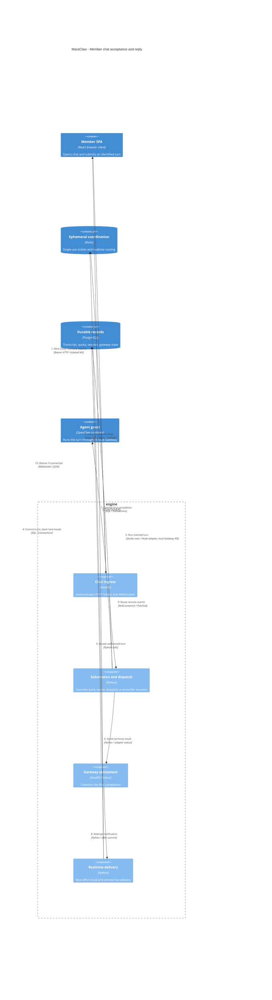

# Durable member chat flow

[Architecture index](README.md) | Source snapshot: **2026-11-12**

This view follows a normal member submission through ticket authorization, durable gateway work, native guest execution, and reply settlement. It omits attachment handling, onboarding triggers, and best-effort web delta streaming. Nginx transport is collapsed into the client-to-engine arrow; see the [deployment view](c4-deployment.md) for the actual proxy hop.

Editable Mermaid C4 source

## Sequence and guarantees

1. **Ticket and socket.** Bearer-authenticated `POST /api/auth/chat-ticket` issues a Redis-backed, single-use ticket; the browser then connects to `/ws/chat/{agent_id}` with the bound session and ticket, not a JWT in the URL. Redemption uses `GETDEL`. Setup and each submitted turn freshly reauthorize the principal, tenant, agent, and session. Steps 1-2 compress this handshake, not parallel actions: [ticket endpoint](../../engine/app/api/auth.py#L72-L82), [ticket service](../../engine/app/services/chat_tickets.py#L47-L121), [socket setup](../../engine/app/api/websocket.py#L318-L395), [per-turn checks](../../engine/app/api/websocket.py#L446-L483).
2. **Durable acceptance before acknowledgement.** `accept_submission` locks the session, checks a submission UUID/fingerprint for replay or conflict, prepares guest configuration, reserves the user transcript, charges quota, updates the session, and inserts gateway work within the owning transaction. Guest configuration is a filesystem side effect, not part of database rollback. Only after successful acceptance does the socket send `turn_accepted`; that acknowledges acceptance, not a finished guest answer: [submission transaction](../../engine/app/services/chat_submissions.py#L69-L139), [model/config preparation](../../engine/app/services/openclaw_routing.py#L52-L85), [socket acknowledgement](../../engine/app/api/websocket.py#L568-L641).
3. **Wake, execute, recover.** After the owning transaction commits, `enqueue_prepared_openclaw_message` wakes native dispatch without blocking the socket. `NativeDispatcher` runs one task per conversation lane (or per message when there is no conversation), bounded per agent by `OPENCLAW_AGENT_MAX_PARALLEL_TURNS` and per process by `OPENCLAW_PROCESS_MAX_PARALLEL_TURNS`; a shared conversation is a single FIFO lane claimed through `claim_ready_shared`. `_run_inbox_wake` claims the lane head, then `execute_gateway_turn` runs it in the label-proven guest through `docker exec` of the Node adapter, which connects only to the guest's local Gateway WebSocket. The worker-owned reconciler rescans pending lane heads every second in keyset pages of 50 and re-wakes them, so a lost wake does not lose committed work; it never replays work already marked delivered. Only a proven refusal before admission (a `not_admitted` outcome, or a lock, configuration, or update-gate refusal before any request is sent) releases a claim, and the released lane then waits out a process-local backoff (1 s, doubling to at most 30 s) before it is retried. A terminal result settles it, and an `uncertain` outcome (an unknown or accepted request, exec timeout, output limit, or cancellation) leaves the turn delivered instead of resubmitting it: [wake and claim](../../engine/app/services/openclaw_routing.py#L139-L225), [post-commit wake](../../engine/app/services/openclaw_routing.py#L266-L283), [dispatcher](../../engine/app/services/openclaw_native_dispatch.py#L19-L171), [lane limits](../../engine/app/services/openclaw_native_capacity.py#L46-L63), [release backoff](../../engine/app/services/openclaw_release_backoff.py#L24-L56), [reconciler](../../engine/app/services/openclaw_dispatch_reconciler.py#L38-L91), [guest execution and outcomes](../../engine/app/services/openclaw_gateway_rpc.py#L171-L322), [adapter](../../engine/connectors/openclaw-dispatcher/gateway-rpc.mjs#L44).
4. **Completion is durable; live notification is not.** The adapter returns one terminal outcome on stdout, and the engine settles it: `settle_native_report` and `record_report` commit gateway completion and, for a non-empty session answer, the assistant transcript together with applicable IM/agent delivery intents. First completion wins, so duplicates do not append duplicate answers. Error and timeout outcomes settle as fixed notices rather than raw adapter errors. For web-origin turns the adapter also streams deltas, which are best effort and bounded; they never replace the terminal result. The subsequent `done` event is best effort: local sockets are served directly and remote instances use Redis presence/PubSub; a missed notification does not undo the transcript. History is read from persisted messages. `POST /api/gateway/report`, `/heartbeat`, and `/send-message` remain API-key endpoints, and `/report` settles through the same `record_report`, but normal dispatch does not depend on a guest-generated report and there is no poll route: [native settlement](../../engine/app/services/openclaw_gateway_delivery.py#L44-L115), [publication](../../engine/app/services/openclaw_gateway_delivery.py#L170-L229), [web deltas](../../engine/app/services/openclaw_gateway_stream.py#L91-L170), [report endpoint](../../engine/app/api/gateway.py#L50-L75), [realtime routing](../../engine/app/services/realtime_runtime/router.py#L161-L211), [history loading](../../engine/app/api/websocket.py#L397-L411).

The diagram is not a token-streaming promise or an exactly-once guest-execution guarantee. Configured guest inference is separate from [engine-side LLM clients](../../engine/app/services/llm/factory.py#L50-L116). When settlement creates IM/agent reply intents, the [worker relay](../../engine/app/services/gateway_report_relay.py#L119-L264) handles them durably outside this member-only flow; Pub/Sub is not that delivery ledger.
